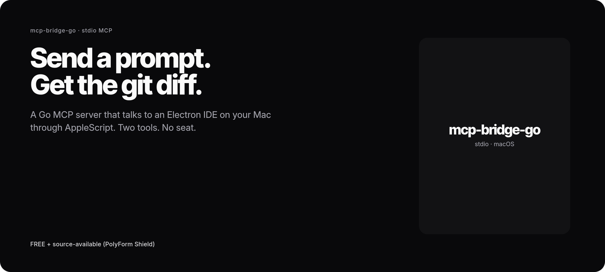
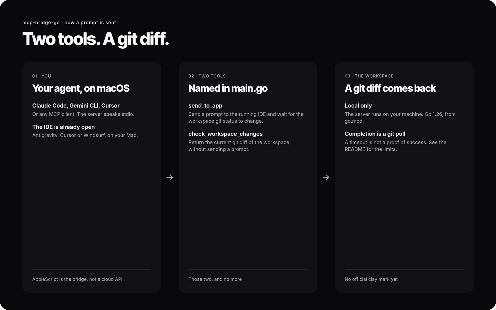

# mcp-bridge-go

<p>
<picture>
  <source media="(prefers-color-scheme: dark)" srcset="docs/images/readme/cover-dark.png">
  <source media="(prefers-color-scheme: light)" srcset="docs/images/readme/cover-light.png">
  
</picture>
</p>

A Go MCP server (stdio) that sends a prompt to an Electron-based AI IDE on macOS (Antigravity, Cursor or Windsurf) and returns the workspace git diff. The IDE must already be open, with a workspace loaded. mcp-bridge-go runs no model of its own and makes no network calls of its own.

Two tools, named in `main.go`: `send_to_app` and `check_workspace_changes`. The default target app is Antigravity (`MCP_BRIDGE_APP`). Go 1.26, from `go.mod`.

FREE + source-available ([PolyForm Shield 1.0.0](LICENSE)).

<p>
  <a href="#quickstart">Quickstart</a> · <a href="#how-it-works">How it works</a> · <a href="#tools">Tools</a> · <a href="#limits">Limits</a> · <a href="#faq">FAQ</a>
</p>

This is not DESIGN:OS Bridge. Bridge is the plugin and CLI that reads and edits the Figma file you have open. See [jangtrinh/design-os-figma-plugin](https://github.com/jangtrinh/design-os-figma-plugin).

## Quickstart

```sh
git clone https://github.com/jangtrinh/mcp-bridge-go.git
cd mcp-bridge-go
make build
```

Configuration is through environment variables. There is no config file.

| Variable | Default | What it is |
| :--- | :--- | :--- |
| `MCP_BRIDGE_APP` | `Antigravity` | Name of the target app |
| `MCP_BRIDGE_SHORTCUT` | `l` | Key used with Cmd to open the chat panel |
| `MCP_BRIDGE_WORKSPACE` | `.` (current directory) | Default workspace path |

Supported values of `MCP_BRIDGE_APP`, as documented in this repository: `Antigravity`, `Cursor`, `Windsurf`. The shortcut is `l` for each of those. The server will talk to any Electron IDE that opens a chat panel with that shortcut, if Accessibility permission is granted.

**Claude Code**

```sh
claude mcp add mcp-bridge \
  --env MCP_BRIDGE_APP=Cursor \
  --env MCP_BRIDGE_WORKSPACE=/path/to/your/project \
  -- /path/to/mcp-bridge
```

**Codex** (`~/.codex/config.toml`)

```toml
[mcp_servers.mcp-bridge]
command = "/path/to/mcp-bridge"

[mcp_servers.mcp-bridge.env]
MCP_BRIDGE_APP = "Cursor"
MCP_BRIDGE_WORKSPACE = "/path/to/your/project"
```

**Gemini CLI** (`~/.gemini/settings.json`) and **Cursor** (`~/.cursor/mcp.json`, or `.cursor/mcp.json` in a project):

```json
{
  "mcpServers": {
    "mcp-bridge": {
      "command": "/path/to/mcp-bridge",
      "env": {
        "MCP_BRIDGE_APP": "Antigravity",
        "MCP_BRIDGE_WORKSPACE": "/path/to/your/project"
      }
    }
  }
}
```

**Claude Desktop** uses the same JSON in `~/Library/Application Support/Claude/claude_desktop_config.json`. Cursor can be both the MCP client and the app that receives the prompt; pointing `MCP_BRIDGE_APP` at a different app (such as Antigravity) is the usual setup.

Pipe an MCP `initialize` request into `/path/to/mcp-bridge` to check that it starts. It replies with `serverInfo.name` set to `mcp-bridge`.

### Paperclip

Build the server and add it to Gemini CLI as above. In Paperclip, set the agent command to `scripts/paperclip-adapter.sh` in this repository. The adapter ignores Claude-specific flags and forwards the prompt on stdin to Gemini CLI, which then calls this server.

## How it works

<p>
<picture>
  <source media="(prefers-color-scheme: dark)" srcset="docs/images/readme/flow-dark.png">
  <source media="(prefers-color-scheme: light)" srcset="docs/images/readme/flow-light.png">
  
</picture>
</p>

`send_to_app` activates the target app through AppleScript, opens the chat panel with the configured shortcut, pastes the prompt, and polls `git status` on the workspace until it changes or `waitSeconds` elapses (default 120). Completion is that git poll, not a reply from the model. A timeout is not a proof of success: the IDE may have asked a question, said that no change was needed, or still be working. The timeout report says whether the app is running and frontmost, and whether the workspace is clean.

`check_workspace_changes` returns the current git status and diff, without sending a prompt.

## Tools

### `send_to_app`

| Parameter | Required | Default | What it is |
| :--- | :--- | :--- | :--- |
| `prompt` | yes | | The prompt to send |
| `workspacePath` | no | `MCP_BRIDGE_WORKSPACE` | Workspace to watch |
| `waitSeconds` | no | `120` | Maximum wait, in seconds |

On success it returns markdown with the prompt, the change status, and the workspace diff. On timeout it returns a diagnostic: app state, workspace state, and what to try next.

### `check_workspace_changes`

| Parameter | Required | Default | What it is |
| :--- | :--- | :--- | :--- |
| `workspacePath` | no | `MCP_BRIDGE_WORKSPACE` | Workspace to inspect |

Returns git status, a diff (at most 5 KB), previews of untracked files (at most 500 characters each), and the three most recent commits.

## Limits

- macOS only. AppleScript is not available on other platforms.
- The target app comes to the foreground. Only one prompt can run at a time.
- The server captures file changes, not the IDE's text reply.
- Work that changes no files times out. See the diagnostic above.
- Accessibility permission is required: System Settings, Privacy & Security, Accessibility, for your terminal or MCP client.
- The target app must be open, with a workspace loaded.

## FAQ

**Is this DESIGN:OS Bridge?** No. This server sends prompts to an IDE on your Mac. DESIGN:OS Bridge reads and edits the Figma file you have open. See [jangtrinh/design-os-figma-plugin](https://github.com/jangtrinh/design-os-figma-plugin).

**Does it work on Linux or Windows?** No.

**Does it use an API key or run a model?** No. The target app uses whatever model you already configured there.

**How does it know the task is done?** It polls git for workspace changes.

## Development

```sh
make audit    # gofmt, go vet, golangci-lint, gosec, go build
make build    # Compile with version, commit and date via ldflags
make lint     # Static analysis only
make clean    # Remove the binary
```

See [CONTRIBUTING.md](CONTRIBUTING.md). Requirements: macOS, Go 1.26 or later (from `go.mod`), and Git.

## DESIGN:OS

mcp-bridge-go is listed on the [DESIGN:OS hub](https://jangtrinh.github.io/). The other products: [Studio](https://github.com/jangtrinh/design-os-studio), [CLI](https://github.com/jangtrinh/design-os), [Bridge](https://github.com/jangtrinh/design-os-figma-plugin), [SVG Animation](https://github.com/jangtrinh/design-os-svg-animation), [Code2Flow](https://github.com/jangtrinh/design-os-code2flow) and [3D Blender](https://github.com/jangtrinh/design-os-3d-blender).

## Contributing and license

- [CONTRIBUTING.md](CONTRIBUTING.md)
- [PolyForm Shield 1.0.0](LICENSE). FREE to use and modify, including for paid client work; you may not resell it or build a competing product from it.

## Listed on

<p align="left">
  <a href="https://mcpservers.org/servers/jangtrinh/mcp-bridge-go"></a>
</p>

Built by [Jang Trịnh](https://github.com/jangtrinh), creative technologist and autonomous system architect.

[GitHub](https://github.com/jangtrinh) · [LinkedIn](https://www.linkedin.com/in/jangtrinh/) · [Hub](https://jangtrinh.github.io/) · [YouTube](https://www.youtube.com/@designosbyjang) · [X](https://x.com/Jangtrinhvn)
